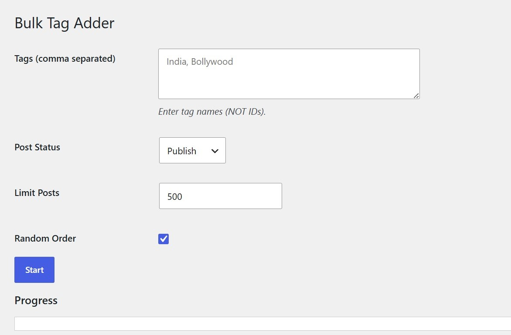

# Bulk Tagger

Very Simple and Fastest way to Randomly Ad some Tags to random Posts.
This Plugin will be Helpfull for thoes who work on Bulk WP Posts, not for Normal Users.

**Setup:**
1. Go to **Tools > Bulk Tag Adder**.
2. Add Tags Select **Post Status** and **Limit Posts** also **Order**.
3. Start and wait for Tags to be added to your posts.
### BulkTagger Dashboard

  

